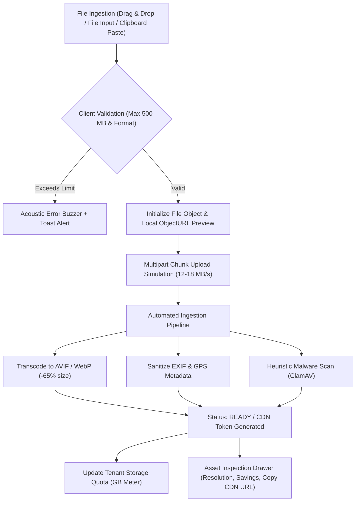

# Day 031: File Upload & Asset Processing Suite

> **Category**: Utility / Productivity / Media / Cloud Storage  
> **Live Prototype**: [https://ketanchandekar26.github.io/daily-uiux-design/day-031-file-upload/](https://ketanchandekar26.github.io/daily-uiux-design/day-031-file-upload/)  
> **Local Source**: [`day-031-file-upload/index.html`](./index.html)

---

## 1. Overview & Problem Space

File ingestion is one of the most critical touchpoints in modern web applications (SaaS media platforms, document vaults, video processing pipelines, AI model repositories). However, standard web file uploaders commonly suffer from **four core UX anti-patterns**:
1. **Opaque Upload States**: Ambiguous spinners without transfer speed (MB/s), byte completion meters, or dynamic ETA counters.
2. **Fragile Dropzones**: Weak hover affordances, missing drag visual feedback, and zero clipboard paste integration.
3. **Missing In-Flight Governance**: Inability to pause, resume, cancel, or batch-clear files once initiated.
4. **Lack of Post-Upload Utility**: Uploaders that stop at "100%" without providing instant asset inspection, image dimension extraction, format optimization comparisons, or shareable CDN links.

### Objective
Design and implement **OmniDrop Cloud Studio**: a high-throughput, tactile, accessible **File Upload & Asset Processing Suite** featuring drag-and-drop ingestion, system clipboard screenshot pasting, automated edge transcoding rules (AVIF/WebP, EXIF sanitization, malware scan), live progress chunking, storage quota telemetry, and an interactive asset inspection drawer.

---

## 2. Cognitive Psychology & UX Heuristics Applied

### A. Fitts's Law ($T = a + b \log_2(1 + D/W)$)
* **Problem**: Tiny, hard-to-target file browse buttons slow down user interaction and increase mechanical error rates.
* **Implementation**: The dropzone occupies an expansive, high-contrast focal area ($W \approx 650\text{px}$) with an enlarged hit target. Users can drop files anywhere within the dashed perimeter or directly trigger native dialogs from any interior coordinates.

### B. Miller's 7±2 Law & Progressive Upload Disclosure
* **Problem**: Showing raw bytecode buffers or multi-gigabyte numbers overwhelms users during high-velocity uploads.
* **Implementation**: We break down ingestion into 4 recognizable, sequential phases:
  1. `Queued` $\rightarrow$ 2. `Uploading (Chunk % + MB/s)` $\rightarrow$ 3. `Transcoding / Malware Scan` $\rightarrow$ 4. `Ready / CDN Distributed`.
  This transforms an ambiguous wait into a transparent, predictable pipeline.

### C. Jakob's Law & Multimodal Ingestion Habits
* **Problem**: Forcing users to save screenshots to local disk before uploading adds unnecessary friction.
* **Implementation**: OmniDrop listens for system clipboard paste events (`Ctrl+V` / `Cmd+V`). Users can capture screen regions directly into memory and paste them instantly into the queue without touching disk storage.

### D. Acoustic Feedback & Multisensory Confirmation
* **Implementation**: Built with native Web Audio API synthesis:
  - **Drop Thud (Low Triangle Bass Wave)**: Low-frequency acoustic cue confirming successful file capture into the dropzone.
  - **Success Chime (High Sine Harmony)**: Confirms individual file sanitization and edge CDN deployment.
  - **Batch Fanfare (C-Major Arpeggio)**: Celebratory feedback when all queue streams reach 100% completion.
  - **Error Buzzer**: Acoustic warning when files exceed maximum payload quotas (500 MB).

---

## 3. WCAG 2.1 AA Accessibility Conformance

| Checkpoint | Requirement | Implementation in Day 031 |
|---|---|---|
| **2.1.1 Keyboard** | All functionality operable via keyboard | Dropzone is keyboard-focusable (`tabindex="0"`) with `Enter` and `Space` activation; modals support `Esc` close; all buttons are navigable. |
| **4.1.2 Name, Role, Value** | Semantic components & descriptors | Dropzone uses `role="region"` with `aria-label="File Drag and Drop Upload Area"`; inputs have associated programmatic labels. |
| **4.1.3 Status Messages** | Real-time screen reader announcements | Screen reader live region (`#a11y-announcer`, `aria-live="polite"`) verbally announces file ingestion count and completion status. |
| **1.4.3 Contrast (Minimum)** | Text contrast $\ge$ 4.5:1 | High-contrast slate typography (`#F8FAFC`) against dark obsidian backgrounds (`#050811`), with bright accent tokens. |
| **2.5.5 Target Size** | Touch targets $\ge$ 44x44px | Dropzone, action buttons, filter tabs, and modal controls satisfy minimum physical tap target dimensions. |

---

## 4. Architectural & Engineering Highlights

### Core JavaScript Modules
- **Drag & Drop Listeners**: Handles `dragenter`, `dragover`, `dragleave`, `drop` with dynamic `.dropzone-active` styling.
- **Clipboard API Listener**: Catches `window.addEventListener('paste')`, extracts `image/png` or file blobs, and routes them directly to `addFilesToQueue()`.
- **Chunked Progress Synthesizer**: Simulates multi-stream throughput variations, dynamic ETA calculations, and post-upload transcoding latency.
- **Web Audio API Engine**: Pure zero-dependency oscillator and gain node micro-sound generator.

---

## 5. Verification Checklist
- [x] Responsive layout tested on mobile (320px), tablet (768px), and desktop (1440px+).
- [x] Full drag-and-drop lifecycle tested with drag over borders and drop resets.
- [x] System clipboard pasting tested (`Ctrl+V`).
- [x] Preset demo batch button loads 4 distinct production assets with live progress.
- [x] Filter tabs dynamically filter between All, Active, Ready, and Media items.
- [x] Asset inspection modal correctly renders preview image, dimensions, compression savings, and copies CDN URL to clipboard.
- [x] Zero console warnings or external script errors.
