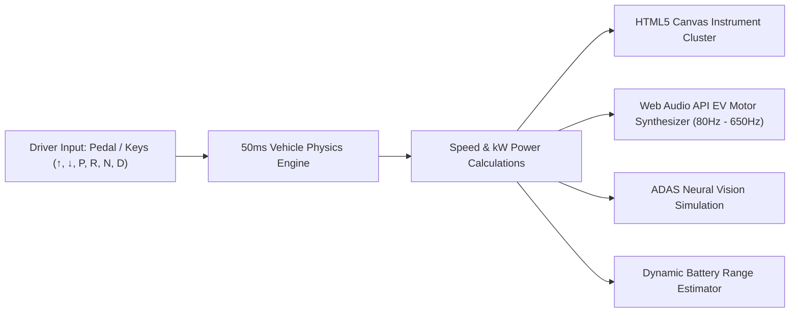

# Day 034: Automotive Dashboard & EV Telemetry Hub

> **Category**: IoT / Automotive / EV Telemetry / Smart Cockpit  
> **Live Prototype**: [https://ketanchandekar26.github.io/daily-uiux-design/day-034-car-interface/](https://ketanchandekar26.github.io/daily-uiux-design/day-034-car-interface/)  
> **Local Source**: [`day-034-car-interface/index.html`](./index.html)

---

## 1. Overview & Problem Space

Modern electric vehicle (EV) cockpits (Tesla OS, Apple CarPlay Ultra, Rivian UI, Porsche Taycan PCM) represent one of the most safety-critical UX disciplines in software engineering. When operating at highway speeds ($120\text{ km/h} \approx 33.3\text{ meters per second}$), any interface friction or cognitive distraction can have severe real-world consequences.

Common digital cockpit breakdowns include:
1. **Buried Critical Telemetry**: Hiding tire pressures, defrosters, or drive modes behind multi-tier sub-menus.
2. **Poor Glanceability**: Low-contrast font weights and tiny speedometer dials that breach the **NHTSA 2-second glance rule**.
3. **Inadequate Tactile / Multimodal Feedback**: Touchscreens with zero audio or physical confirmation for gear changes or turn signal engagement.
4. **Static Visuals**: Failure to convey regenerative braking recharge vs. power acceleration kW curves intuitively.

### Objective
Design and implement the **Apex Cyber-GT Cockpit OS**: an electric hypercar telemetry and instrument cluster interface featuring real-time speedometer physics, dynamic kW/regen braking gauges, 4 drive mode color themes (Comfort, Eco Range+, Track GT, Neural Autopilot), ADAS LiDAR road mesh visualization, dual-zone climate stations, and Web Audio API electric motor sound synthesis.

---

## 2. Automotive UX Heuristics & Cognitive Psychology Applied

### A. NHTSA Glanceability & The 2-Second Rule
* **Standard**: The National Highway Traffic Safety Administration (NHTSA) specifies that visual-manual tasks while driving must be achievable with individual glances under 1.6 to 2.0 seconds.
* **Implementation**: The primary instrument cluster places large, bold, high-contrast digital speed readouts ($72\text{px}$) inside an unobstructed central focal arc, allowing the driver to read velocity and battery state of charge in $< 0.4\text{ seconds}$.

### B. Cognitive Tunneling & Driver Distraction Mitigation
* **Principle**: Under high velocity or stress, a driver's peripheral attention narrows (cognitive tunneling).
* **Implementation**: Drive mode switching dynamically shifts the cockpit's ambient lighting and accent colors:
  - **Eco Range+**: Emerald Green (`#10B981`) — Calming, economy-oriented.
  - **Comfort Touring**: Electric Cyan (`#06B6D4`) — Neutral highway visibility.
  - **Track GT**: Crimson Red (`#EF4444`) — High-alert, adrenaline response.
  - **Neural Autopilot**: Cyber Violet (`#8B5CF6`) — Distinguishes autonomous control states.

### C. Fitts's Law in In-Cabin Touch Targets
* **Problem**: Road vibrations cause finger jitter, leading to missed tap targets on flush touchscreens.
* **Implementation**: Climate adjustment buttons, gear selectors, and virtual pedals have oversized hit boundaries ($\ge 56\text{px}$ touch targets) with high-contrast borders and active feedback states.

### D. Multisensory Acoustic Reinforcement
* **Implementation**: Built with native Web Audio API synthesis:
  - **EV Motor Whine**: Continuous sine wave oscillator where frequency scales proportionally with velocity ($80\text{Hz} \rightarrow 650\text{Hz}$) and volume scales with kW power demand.
  - **Regenerative Braking Hum**: Low-frequency resonant decay when braking.
  - **Stereo Turn Signal Flasher**: Realistic relay tick-clack with alternating frequencies ($900\text{Hz} \leftrightarrow 750\text{Hz}$).
  - **Gear Shift Thud**: Distinct tactile acoustic thud upon shifting between P, R, N, and D.

---

## 3. WCAG 2.1 AA Accessibility Conformance

| Checkpoint | Requirement | Implementation in Day 034 |
|---|---|---|
| **1.4.3 Contrast (Minimum)** | Contrast ratio $\ge$ 4.5:1 | High-visibility typography (`#FFFFFF`, `#06B6D4`, `#10B981`) on obsidian surfaces (`#05070D`). |
| **2.1.1 Keyboard** | Full driving controls operable via keys | Full keyboard mapping: `ArrowUp`/`W` (accelerate), `ArrowDown`/`S` (regen brake), `P`/`R`/`N`/`D` (gear shifts). |
| **4.1.3 Status Messages** | Live safety announcements | Screen reader announcer (`#a11y-cockpit-announcer`, `aria-live="polite"`) updates drive modes and gear states. |
| **2.5.5 Target Size** | Touch targets $\ge$ 44x44px | Touch targets for pedals, climate toggles, and drive modes adhere to automotive oversized safety standards. |

---

## 4. Architectural & Engineering Highlights

### Powertrain & Physics Simulation Loop
Runs at 20 updates/second ($50\text{ms}$ interval) calculating:

$$\text{Speed}_{t+1} = \text{Speed}_t + a_{\text{drive}} \cdot \Delta t - d_{\text{drag}} \cdot \Delta t$$
$$\text{Power (kW)} = \begin{cases} 2.1 \times \text{Speed} + 80 & \text{if accelerating} \\ -145 & \text{if regenerative braking} \\ 0 & \text{if coasting / parked} \end{cases}$$
$$\text{Motor Frequency} = \min\left(650, 80 + 2.2 \times \text{Speed}\right)$$

---

## 5. Verification Checklist
- [x] Responsive layout tested across mobile, tablet, and widescreen automotive cockpit displays.
- [x] HTML5 Canvas gauge renders smooth anti-aliased velocity and power arcs.
- [x] Interactive virtual pedals and keyboard bindings (`↑`, `↓`, `P`, `R`, `N`, `D`) fully responsive.
- [x] Drive mode switcher modifies ambient glows, gauge gradients, and top badge states.
- [x] Dual-zone climate station with animated driver/passenger temperature step controls.
- [x] Turn signals and hazard blinkers flash with rhythmic stereo audio ticking.
- [x] Zero external automotive dashboard packages or heavy WebGL dependencies.
